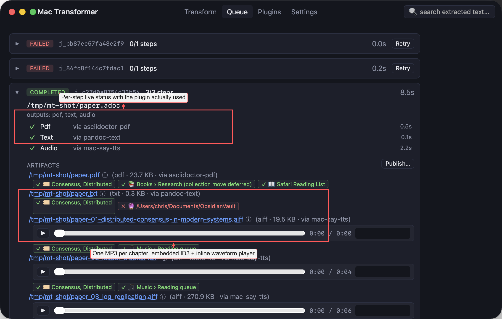

# Mac Transformer

Convert documents into **PDF**, **plain text**, **spoken audio**, and **AI-generated summaries** through a pluggable pipeline. Optionally publish to Apple Books, Apple Music, Safari Reading List, Obsidian vaults, or Notion databases. Runs on macOS 12+.

Input formats: **docx, doc, rtf, pptx, ppt, odt, odp, ods, xlsx, pdf, md, adoc, rst, org, html, txt** (and any format your locally-installed converters know about — plugins add support without recompiling).

## Run modes

- **Menu-bar app** — SwiftUI-style Wails v3 window + tray icon with live job counter, drop zone, queue view, settings, inline audio player, full-text search
- **REST server** on `127.0.0.1:8771` — every action in the app is also an HTTP endpoint
- **MCP endpoint** at `POST /mcp` — the app appears in Claude Code as `mcp__mac-transformer__transform` and friends
- **Finder integration** — right-click → Open With, or right-click → Quick Actions → Send to Mac Transformer
- **CLI** (`mt`) — thin shell client for scripting / Alfred / launchd
- **Watch folders** — drop a file into a configured directory, it processes automatically
- **Safari share** — services menu entry accepts URLs from any app

## Quickstart

```sh
# Clone
git clone https://github.com/geekychris/mac_transformer.git
cd mac_transformer

# Install runtime dependencies (LibreOffice, pandoc, poppler, ffmpeg, ...).
# Prompts before each; skip any you don't want.
./scripts/install-deps.sh

# Build the .app and install to /Applications
./scripts/install.sh
```

Then `open /Applications/Mac\ Transformer.app` — the menu bar shows an `MT` icon.

## First-time conversion

```sh
# Drop a file — result lands next to the source
mt transform ~/Documents/paper.docx --outputs pdf,text,audio --wait
```

Or use the app: paste a path, click **Transform**.

## Screenshots

The Queue view with a completed 3-artifact chapter-split job (PDF + text + 3-chapter audio), published to Books + Reading List + Obsidian and tagged with `Consensus, Distributed`:



More annotated views (Transform, Plugins, Settings, failed-job error handling) are in **[docs/SCREENSHOTS.md](docs/SCREENSHOTS.md)**.

## Documentation

- **[docs/ARCHITECTURE.md](docs/ARCHITECTURE.md)** — how the pieces fit together, the request lifecycle, and design decisions
- **[docs/BUILD.md](docs/BUILD.md)** — building from source, dev loop, packaging
- **[docs/PLUGINS.md](docs/PLUGINS.md)** — writing a plugin (converter or sink) without recompiling
- **[docs/CONFIG.md](docs/CONFIG.md)** — every config knob, its default, and what it does
- **[docs/API.md](docs/API.md)** — REST endpoints, MCP tools, request/response shapes
- **[docs/SCREENSHOTS.md](docs/SCREENSHOTS.md)** — annotated tour of every tab

## Features at a glance

| Category | What you get |
|---|---|
| **Conversion** | PDF via Microsoft Word / LibreOffice / Pandoc / asciidoctor-pdf. Text via Pandoc / Word / pdftotext. Audio via [Kokoro](https://github.com/geekychris/kokoro_runtime) or macOS `say`. OCR for scanned PDFs via macOS Vision. AI summaries via any OpenAI-compatible endpoint (Claude, GPT, local Ollama). |
| **Output layout** | Beside the input, flat in one dir, or in a per-file subfolder |
| **Audio** | Chapter-split by headings, ID3 tags, auto-generated cover art (embedded as APIC frame) |
| **Publish** | 📚 Books · 🎵 Music · 📖 Safari Reading List · 🔮 Obsidian · 📝 Notion · 🏷 Finder tags |
| **Automation** | Watch folders, recipes (saved presets), duplicate detection, retry failed step |
| **UX** | Live per-step progress, inline audio player with waveform, full-text search across artifacts, cancel running jobs, native notifications |
| **Persistence** | Jobs survive restarts (`~/.mac-transformer/jobs.jsonl`) |
| **Extensibility** | Every converter is a YAML plugin — drop a manifest into `plugins/` |

## Trigger surfaces

| From | How |
|---|---|
| **App** | Drop files onto the window, or paste absolute paths |
| **Finder** | Right-click → Open With → Mac Transformer, or Quick Actions → Send to Mac Transformer |
| **Terminal** | `mt transform file.docx --outputs pdf,audio --recipe Audiobook` |
| **REST** | `curl -X POST http://127.0.0.1:8771/transform -d '{"path":"/abs/path.md","outputs":["audio"]}'` |
| **MCP (Claude Code)** | `mcp__mac-transformer__transform` |
| **Safari Share** | Select a URL → Share → "Send to Mac Transformer" (Services menu) |
| **Watch folders** | Drop a file into a configured `Inbox` folder |

## Trigger surfaces (visual)

```
┌─────────────────┐      ┌─────────────────────────────────────────────┐
│  Finder         │──┐   │           Mac Transformer                   │
│  (right-click)  │  │   │                                             │
├─────────────────┤  │   │  ┌──────────────┐   ┌────────────────────┐  │
│  Drag onto      │──┼──▶│  │  REST /mcp   │   │  Wails GUI + Tray  │  │
│  dock icon      │  │   │  │  :8771       │   │                    │  │
├─────────────────┤  │   │  └──────┬───────┘   └─────────┬──────────┘  │
│  mt CLI         │──┤   │         │                     │             │
├─────────────────┤  │   │         ▼                     ▼             │
│  curl / MCP     │──┤   │  ┌────────────────────────────────────────┐ │
│  clients        │  │   │  │           Core dispatcher              │ │
├─────────────────┤  │   │  │  ┌──────────┐  ┌──────────────────┐    │ │
│  Watch folders  │──┤   │  │  │ Plugins  │  │  Post-processing │    │ │
├─────────────────┤  │   │  │  │ (YAML)   │  │  (publish/sinks) │    │ │
│  Safari share   │──┘   │  │  └──────────┘  └──────────────────┘    │ │
└─────────────────┘      │  └────────────────────────────────────────┘ │
                         │         │                     │             │
                         │         ▼                     ▼             │
                         │   PDF / TXT / MP3 / AIFF / MD summary        │
                         │   →  Books · Music · Reading List · Obsidian │
                         │      · Notion · Finder tags                  │
                         └─────────────────────────────────────────────┘
```

## License

MIT. Kokoro weights (if used) are Apache 2.0. LibreOffice is MPLv2. See `LICENSE` for the app itself.

## Development

```sh
# Run frontend + backend hot-reload
wails3 dev

# Just the Go tests
go test ./...

# Package + install to /Applications
./scripts/install.sh
```

For architecture details, see [docs/ARCHITECTURE.md](docs/ARCHITECTURE.md).
