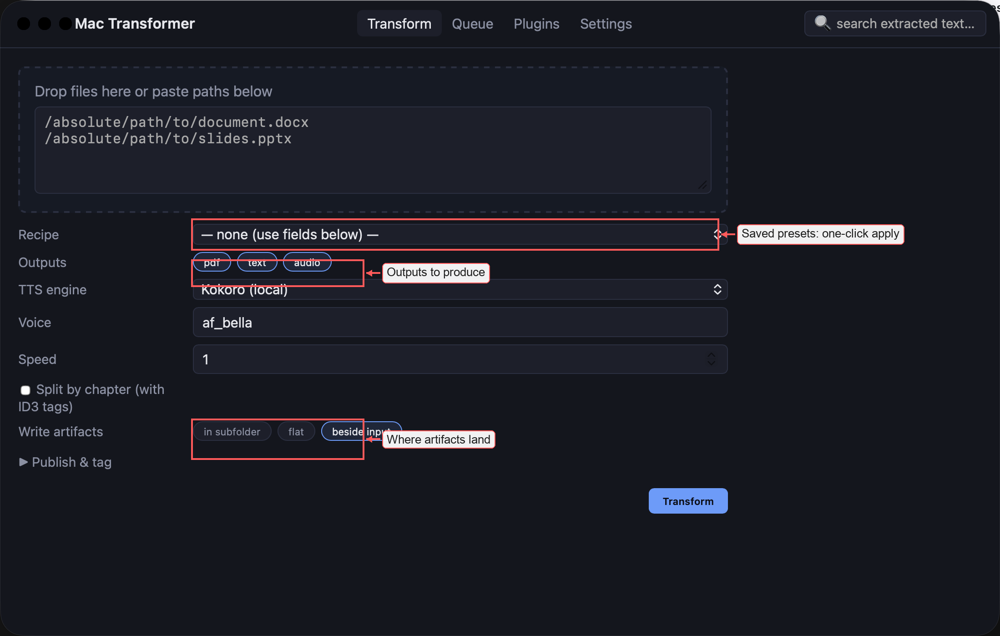
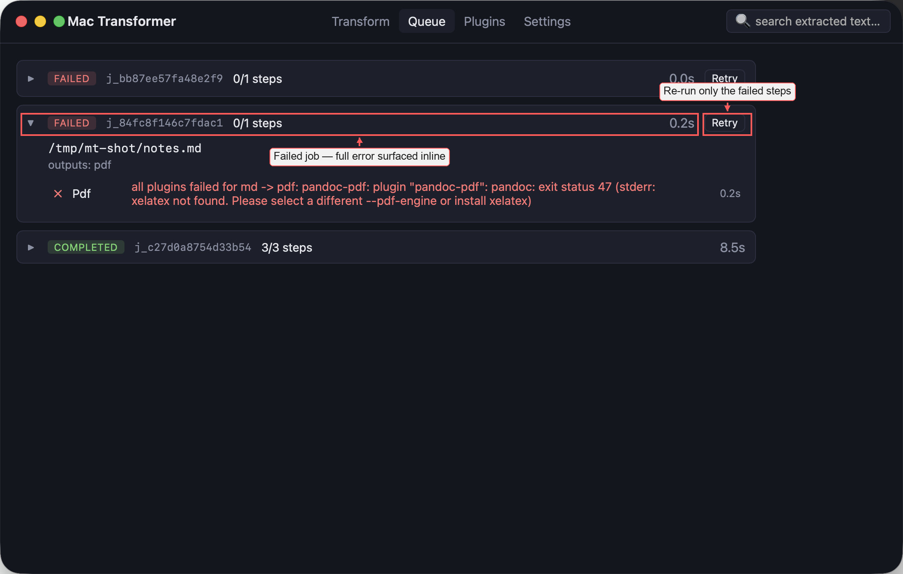
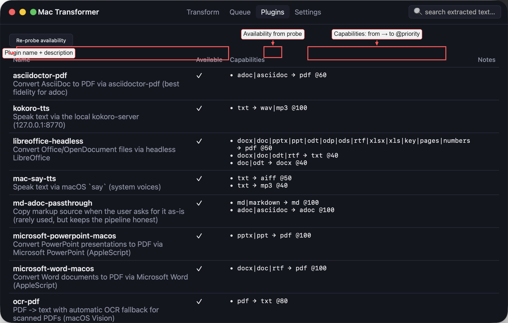
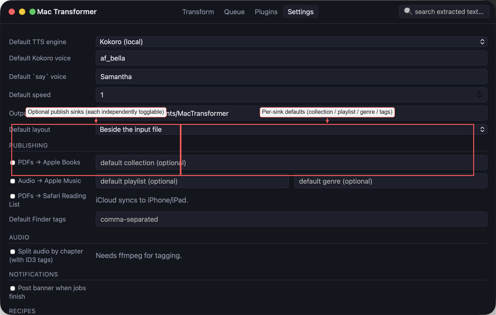
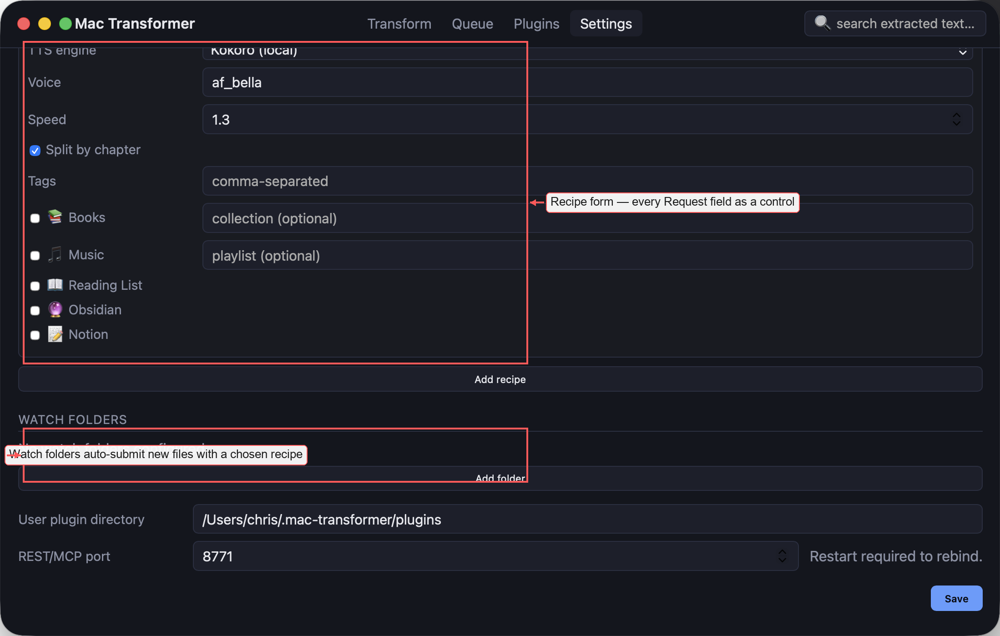

# Screenshots

Annotated views of every major app surface. Raw (unannotated) versions live in [`images/raw/`](images/raw).

## Transform tab

The primary submit view. Drag files onto the drop zone (or paste absolute paths), choose outputs, optionally pick a saved recipe, and click **Transform**.

- **Recipe picker** — top-most control; when set, it applies a saved preset that pre-fills the rest of the form.
- **Outputs** — chips for `pdf`, `text`, `audio`, `summary`. Pick any subset.
- **Layout** — where artifacts go relative to the input: beside, flat in the output dir, or in a per-input subfolder.
- **Publish & tag** — expand to configure per-sink options (📚 Books, 🎵 Music, 📖 Reading List, 🔮 Obsidian, 📝 Notion, 🏷 Finder tags).

## Queue tab — completed job

The workhorse view. Each job is a collapsible card; running/failed jobs auto-expand.

- **Per-step status** with the plugin actually used (`Pdf via asciidoctor-pdf`, `Text via pandoc-text`, `Audio via mac-say-tts`). When the top-priority plugin fails, fallback plugins are recorded here.
- **Inline audio player** per artifact with a live waveform (Canvas + WebAudio AnalyserNode). Media keys work via `MediaSession`. Chapter-split audio produces one player per chapter, each with its own ID3 tags and cover art.
- **Publish results** — one chip per sink invoked (`✓ 📚 Books › Research`, `✓ 📖 Safari Reading List`, `✓ 🏷 Consensus, Distributed`, `✓ 🔮 …/ObsidianVault`).
- **Publish…** button — retroactively apply Books/Music/Reading List/Obsidian/Notion/tags to a job that was submitted without them.
- **Artifact links** — click any file path to open with the OS default app; the ⓘ next to it reveals in Finder.

## Queue tab — failed job

Failed jobs surface the full plugin error inline so you can see exactly why.

- The full error message from the failing plugin, including subprocess stderr (in this case: `xelatex not found`).
- **Retry** button — re-runs only the failed steps of the job, creating a fresh job id linked to the original via `X-Retry-Of`.

## Plugins tab

The registry of all converter plugins, with availability from their probe checks.

- **Name + description** from each plugin's YAML manifest.
- **Available** column — result of the plugin's requirements probe (`binary`, `app-bundle`, `http`, `gem`, `file`). Unavailable plugins are dim; a `Notes` column shows the specific reason.
- **Capabilities** — `input formats → output formats @ priority`. Higher priority wins ties; failure falls back down the priority list. Users can force a specific plugin per conversion via `plugin_overrides`.
- **Re-probe availability** button — re-runs every probe without a restart, useful after installing a new tool.

## Settings — publishing

Every optional sink can be enabled by default (and overridden per job).

- **Publishing section** — one row per sink. Sinks are independently togglable.
- **Per-sink defaults** — collection for Books, playlist + genre for Music, folder for Obsidian, database id + token for Notion, comma-separated Finder tags applied to every artifact.
- Reading List has no per-item config — it's just a boolean.

## Settings — recipes & watch folders

Recipes are saved templates; watch folders auto-submit any file that lands in them.

- **Recipe form** — every `Request` field is a form control (outputs chips, layout dropdown, TTS engine/voice/speed, publish toggles, tags). The form is regenerated from the schema so new sinks show up automatically.
- **Watch folders** — a directory path, an optional recipe name, and an extension filter. `fsnotify`-driven, debounced by 1.5s so a single file save doesn't fire three jobs.
